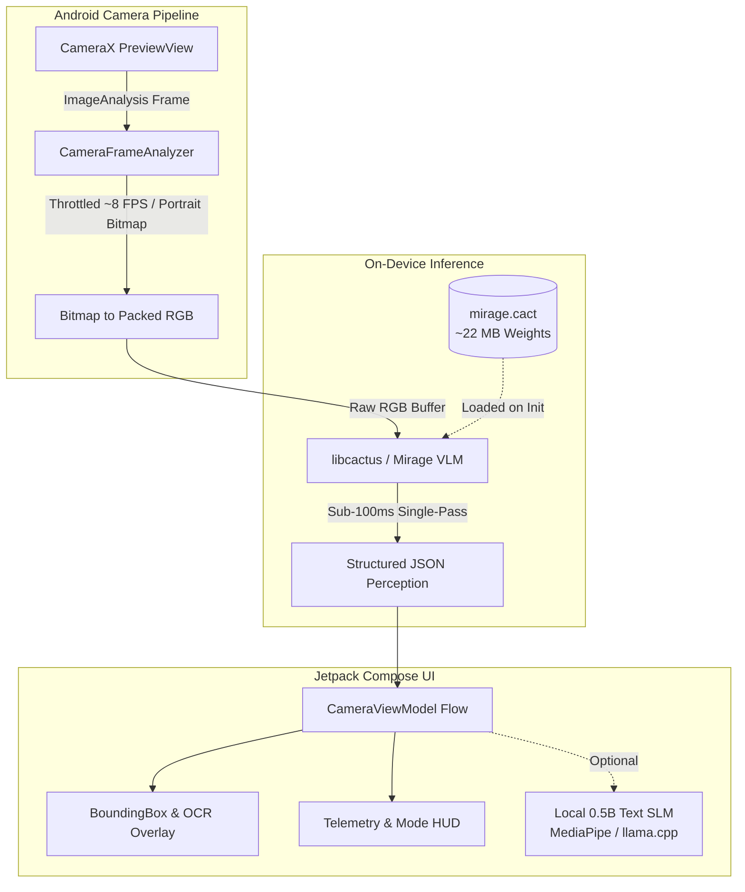

<div align="center">

# 👁️ Eko Vision

**Ultra-Lightweight On-Device Vision Intelligence for Android**  
*Powered by Mirage (~22 MB Vision-Language Model by Cactus Compute)*

[](https://github.com/sohamdalwadi/eko-vision/actions/workflows/build-apk.yml)
[](https://github.com/sohamdalwadi/eko-vision/releases/tag/stable-latest)
[](https://github.com/sohamdalwadi/eko-vision/releases/tag/beta-latest)
[](LICENSE)
[](CONTRIBUTING.md)

<p align="center">
  <b>100% On-Device</b> • <b>Sub-100ms Latency</b> • <b>Zero Cloud Calls</b> • <b>Full Hardware Privacy</b>
</p>

</div>

---

## 📲 Download & Try the APK

We provide rolling, automatically verified APK builds straight from GitHub Actions:

| Build Channel | Branch | APK Download | Target Audience |
| :--- | :--- | :--- | :--- |
| **Stable Channel** | [`main`](https://github.com/sohamdalwadi/eko-vision/tree/main) | [**Download Stable APK**](https://github.com/sohamdalwadi/eko-vision/releases/tag/stable-latest) | General users, stable demos, verified features. |
| **Beta Channel** | [`dev`](https://github.com/sohamdalwadi/eko-vision/tree/dev) | [**Download Beta APK**](https://github.com/sohamdalwadi/eko-vision/releases/tag/beta-latest) | Contributors, testers, and previewing active pull requests. |

> [!NOTE]
> **Space-Saving Rolling Builds:** To keep GitHub storage clean and within free limits, only the **latest** build of each channel is preserved. Older builds and intermediate workflow runs are automatically pruned.

---

## 🌟 Overview

**Eko Vision** is an open-source, modular Android application and reference demo showcasing **Mirage**—an ultra-compact ~22 MB on-device Vision-Language Model (VLM) developed by [Cactus Compute](https://cactuscompute.com). 

While traditional multi-modal VLMs require 2 GB to 8 GB+ of RAM and heavyweight servers, Mirage compresses 51.3M parameters into just **~22 MB of 2-bit weights**, executing comprehensive visual perception in under **80 ms on mobile NPU / ~110 ms on CPU**.

Eko Vision turns your smartphone into a real-time visual perception HUD with normalized bounding boxes, instant OCR, spatial reasoning, and scene understanding—running entirely offline without sending a single pixel over the network.

---

## 🎯 Architecture & Data Flow



---

## 🌿 Branching Strategy

To keep development fast, stable, and contributor-friendly, we follow a simple two-tier branching strategy:

```
[ feature/* ] ────────► (PR & Automated APK Verification)
                             │
                             ▼
  [ dev ] ──────────────────────────────────────────► (Builds Beta APK)
    │
    ▼ (Periodic Stabilization & Testing)
  [ main ] ─────────────────────────────────────────► (Builds Stable APK)
```

1. **`main` (Stable):** Represents production-ready code. Merges occur from `dev` only after features are stabilized.
2. **`dev` (Development):** The active integration branch. All community contributions and feature pull requests must target `dev`.
3. **`feature/*`:** Individual feature or bugfix branches created from `dev`.

Every pull request automatically triggers an APK build in CI to verify that code compiles cleanly and introduces no regressions.

---

## 🗺️ Roadmap & Contribution Areas

We welcome contributions of all levels! Here is our current roadmap:

- [x] **Phase 1: Foundation (Current MVP)**
  - [x] CameraX integration with thread-safe `CameraFrameAnalyzer`
  - [x] Mirage engine contract & RGB buffer serializer
  - [x] Compose Canvas bounding box overlay with confidence scores
  - [x] Performance telemetry HUD (FPS, inference latency in ms)
  - [x] Freeze/Pause frame inspector
  - [x] GitHub Actions automated APK build & rolling release pipeline
- [ ] **Phase 2: Smart Extraction & Forms**
  - [ ] Structured receipt, invoice, and business card schema parsing
  - [ ] One-tap export to JSON / Room DB / CSV
  - [ ] Document boundary detection & perspective correction
- [ ] **Phase 3: Assistive & Voice Mode**
  - [ ] Android Text-to-Speech (TTS) integration for spatial narration
  - [ ] Haptic feedback when objects enter center focus
  - [ ] Offline audio cues for visually impaired navigation
- [ ] **Phase 4: On-Device Multimodal Copilot**
  - [ ] Pipe Mirage JSON perceptions into local SLMs (e.g. Qwen-2.5-0.5B via MediaPipe or llama.cpp)
  - [ ] Conversational Q&A about what the camera sees (*"What type of cable is this?"*)
- [ ] **Phase 5: Background Gallery Indexing**
  - [ ] WorkManager batch indexing for device photos
  - [ ] Local semantic search (find photos by natural language description)

---

## 🛠️ Project Structure

```
eko-vision/
├── .github/workflows/
│   └── build-apk.yml                        # Automated CI/CD, verification & rolling releases
├── app/
│   ├── src/main/
│   │   ├── AndroidManifest.xml
│   │   └── java/com/eko/vision/
│   │       ├── EkoVisionApp.kt               # App class (Engine initialization)
│   │       ├── MainActivity.kt               # Edge-to-edge entry point
│   │       ├── core/
│   │       │   ├── camera/
│   │       │   │   └── CameraFrameAnalyzer.kt # CameraX frame analyzer & throttling
│   │       │   ├── engine/
│   │       │   │   └── MirageEngine.kt       # Bridge to Cactus Mirage weights
│   │       │   └── model/
│   │       │       └── MiragePerception.kt   # Perception data classes & JSON models
│   │       └── presentation/
│   │           ├── camera/
│   │           │   ├── CameraScreen.kt       # Main camera compose screen
│   │           │   ├── CameraViewModel.kt    # UI state & frame coordinator
│   │           │   └── components/
│   │           │       ├── BoundingBoxOverlay.kt # Compose Canvas overlays
│   │           │       └── PerceptionHud.kt      # Telemetry & controls HUD
│   │           └── theme/
│   │               └── Theme.kt              # Sleek HUD Material3 dark theme
│   ├── build.gradle.kts
│   └── proguard-rules.pro
├── gradle/
│   ├── wrapper/                             # Gradle wrapper configuration
│   └── libs.versions.toml                   # Gradle Version Catalog
├── build.gradle.kts
├── settings.gradle.kts
├── LICENSE                                  # Apache 2.0 License
├── CONTRIBUTING.md                          # Contribution guidelines & branching model
└── README.md
```

---

## 💻 Getting Started

### Prerequisites
* **Android Studio Ladybug (2024.2+)** or newer
* **JDK 17** configured in Gradle
* Android Device with **API 26+ (Android 8.0+)** and ARM64 architecture (physical device recommended for CameraX and NPU acceleration)

### Build & Run
1. **Clone the repository:**
   ```bash
   git clone https://github.com/sohamdalwadi/eko-vision.git
   cd eko-vision
   git checkout dev
   ```
2. **Obtain Mirage Model Weights (`mirage.cact`):**
   * Download the official 22MB Mirage weights from [Cactus Compute Hugging Face](https://huggingface.co/Cactus-Compute/mirage).
   * Place `mirage.cact` in `app/src/main/assets/` (or let the app download it dynamically).
3. **Open in Android Studio:**
   * Sync Gradle with Project Files.
   * Connect an Android device with USB debugging enabled.
   * Click **Run (Shift + F10)**.

---

## 🤝 Contributing

We love contributions! Please read our [Contribution Guidelines](CONTRIBUTING.md) for details on our branching workflow and how PR verification works.

---

## 📄 License

This project is licensed under the **Apache License 2.0** — matching the upstream Cactus Compute license. See the [LICENSE](LICENSE) file for details.

---

<div align="center">
  <sub>Built with ❤️ by the open-source community. Special thanks to the Cactus Compute team for pioneering micro-VLM edge intelligence.</sub>
</div>
