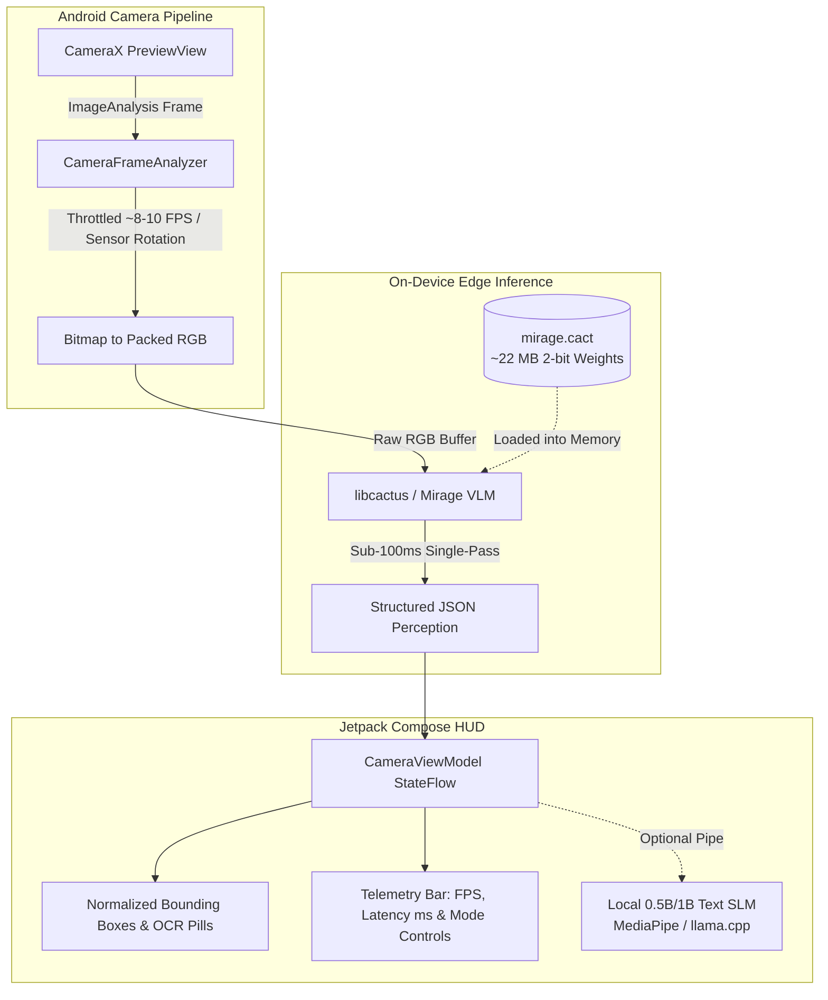

<div align="center">

# 👁️ Eko Vision: Real-Time On-Device AI Vision for Android
### Powered by Mirage (22MB Vision-Language Model by Cactus Compute)

[](https://github.com/sohamdalwadi/eko-vision/actions/workflows/build-apk.yml)
[](https://github.com/sohamdalwadi/eko-vision/releases/tag/stable-latest)
[](https://github.com/sohamdalwadi/eko-vision/releases/tag/beta-latest)
[](LICENSE)
[](CONTRIBUTING.md)
[](#why-mirage-vlm)
[](#benchmarks)

<p align="center">
  <b>Real-Time AI Vision</b> • <b>Mirage VLM</b> • <b>100% Offline Edge Intelligence</b> • <b>Zero Cloud Latency & Zero API Fees</b>
</p>

</div>

---

## 🔍 What is Eko Vision?

**Eko Vision** is the premier open-source Android demonstration and playground for **Mirage Vision**—an ultra-compact **~22 MB Vision-Language Model (VLM)** developed by [Cactus Compute](https://cactuscompute.com). 

Built with **Jetpack Compose** and **CameraX**, Eko Vision turns any Android smartphone into an intelligent, edge-native perception HUD. It runs full multimodal visual perception directly on device hardware—delivering instant **object detection (bounding boxes)**, **optical character recognition (OCR)**, **spatial relations analysis**, and **scene description** in a single sub-100ms forward pass without sending a single frame to the cloud.

---

## ⚡ Why Mirage Vision? (22 MB vs 2 GB+ Heavy VLMs)

Traditional Vision-Language Models (such as PaliGemma, LLaVA, or MobileVLM) require **1.5 GB to 8 GB+ of RAM**, drain smartphone batteries, and rely on server clusters. 

**Mirage takes a radical new architecture approach:**
* **Size:** **~22 MB** weights file (compressed with custom 2-bit Cactus Quants for ~51.3M parameters).
* **Speed:** **~74 ms on mobile NPU** and **~107 ms on mobile CPU** (benchmarked on consumer hardware).
* **Structured Output:** Instead of burning millions of parameters generating chat prose, Mirage outputs **rich structured JSON** containing bounding boxes, OCR strings, spatial relationships, and visual reasoning traces.
* **Text LLM Synergy:** Mirage's structured JSON perception can be piped directly into any local small text model (e.g., Qwen-2.5-0.5B, Llama-3.2-1B, or Gemma-2B via MediaPipe or `llama.cpp`) to create a full multimodal conversational copilot locally.

### 📊 Benchmark Comparison

| Model | Model Size | RAM Usage | On-Device Mobile Latency | Offline / Private | Primary Target |
| :--- | :--- | :--- | :--- | :--- | :--- |
| **Mirage (Eko Vision)** | **~22 MB** | **~60 MB** | **~74 ms (NPU) / 107 ms (CPU)** | ✅ **100% Offline** | **Smartphones, Wearables, Edge** |
| **MobileVLM-3B** | ~3,000 MB | ~4.2 GB | ~1,200 ms | ⚠️ High Memory Pressure | High-end Flagships |
| **PaliGemma-3B** | ~3,200 MB | ~4.5 GB | ~1,500 ms | ⚠️ High Memory Pressure | Server / Desktop |
| **Cloud VLMs (GPT-4o / Gemini Flash)** | Cloud-Hosted | Cloud | 800–2,500 ms (Network Dependent) | ❌ Transmits Video Frames | Cloud Server APIs |

---

## 📲 Download & Try the APK

Automated, verified APKs are compiled on every commit via GitHub Actions:

| Build Channel | Branch | APK Download | Target Audience |
| :--- | :--- | :--- | :--- |
| **Stable Channel** | [`main`](https://github.com/sohamdalwadi/eko-vision/tree/main) | [**Download Stable APK**](https://github.com/sohamdalwadi/eko-vision/releases/tag/stable-latest) | General users, stable demos, verified features. |
| **Beta Channel** | [`dev`](https://github.com/sohamdalwadi/eko-vision/tree/dev) | [**Download Beta APK**](https://github.com/sohamdalwadi/eko-vision/releases/tag/beta-latest) | Contributors, testers, and previewing active pull requests. |

---

## 🎯 Architecture & Data Flow



---

## 🚀 Key Features

* **⚡ Real-Time HUD Overlay:** Sub-100ms single-pass detection rendering normalized bounding boxes, confidence tags, and OCR text directly onto Compose Canvas.
* **🔒 100% Privacy & Zero Network Calls:** Camera frames never leave local memory. HIPAA, GDPR, and enterprise ready.
* **🔋 Thermal & Battery Conscious:** CameraX frame analyzer throttles sampling to ~8–10 FPS, preventing device overheating and battery drain.
* **📱 Ultra-Small Binary Overhead:** Adds only ~25 MB total to the Android app footprint (22MB weights + ~3MB native engine).
* **🧩 Clean Architecture:** Kotlin 2.1, Jetpack Compose Material3, Coroutines, StateFlow, and Gradle Version Catalog.

---

## 🌿 Branching Strategy & Git Flow

To maintain high release stability while allowing rapid community development, we follow this branching workflow:

```
feature/your-feature
        │
        ▼ (PR with automated compile & APK verification)
      [ dev ]  ──────► Automated CI builds "Beta APK"
        │
        ▼ (Merge when tested & stable)
     [ main ]  ──────► Automated CI builds "Stable APK" (Protected Branch)
```

* **`main` (Stable):** Production-ready code. Direct pushes are restricted via GitHub branch protection.
* **`dev` (Active Development):** Primary integration branch. All community pull requests target `dev`.
* **`feature/*`:** Individual developer and contributor branches.

---

## 🗺️ Roadmap & Contribution Areas

We welcome contributions of all skill levels! Here is our feature roadmap:

- [x] **Phase 1: Foundation (Current MVP)**
  - [x] CameraX integration with thread-safe `CameraFrameAnalyzer`
  - [x] Mirage engine contract & RGB buffer serializer
  - [x] Compose Canvas bounding box overlay with confidence scores
  - [x] Performance telemetry HUD (FPS, inference latency in ms)
  - [x] Freeze/Pause frame inspector
  - [x] Automated CI/CD APK build and rolling release pipeline
- [ ] **Phase 2: Smart Document & Form Extraction**
  - [ ] Structured receipt, invoice, and business card schema parsing
  - [ ] One-tap export to JSON / Room DB / CSV
  - [ ] Document boundary detection & perspective correction
- [ ] **Phase 3: Assistive & Voice Mode**
  - [ ] Android Text-to-Speech (TTS) integration for spatial narration
  - [ ] Haptic feedback when objects enter center focus
  - [ ] Offline audio cues for visually impaired navigation
- [ ] **Phase 4: On-Device Multimodal Copilot**
  - [ ] Pipe Mirage JSON perceptions into local SLMs (e.g. Qwen-2.5-0.5B via MediaPipe or llama.cpp)
  - [ ] Conversational Q&A about what the camera sees (*"What tool should I use for this screw?"*)
- [ ] **Phase 5: Background Gallery Indexing**
  - [ ] WorkManager batch indexing for device photos
  - [ ] Local semantic search (find photos by natural language description)

---

## ❓ Frequently Asked Questions (FAQ)

### What is Mirage Vision?
Mirage is an ultra-compact (~22 MB) Vision-Language Model created by Cactus Compute. It combines an efficient Hadamard-transform image encoder, a language decoder, and specialized OCR and spatial heads into a ~51.3 million parameter architecture quantized to 2 bits.

### How does Mirage run so fast on mobile devices?
By offloading conversational text-generation overhead and focusing strictly on perception, Mirage completes inference in ~74ms on mobile NPUs and ~107ms on mobile CPUs, enabling smooth real-time video feed analysis.

### Can Eko Vision work completely offline?
Yes! Eko Vision executes 100% on-device. No internet connection, cellular data, or cloud API keys are required.

### Can I pair Mirage with a local text LLM?
Yes! Because Mirage outputs structured JSON records containing detected objects, coordinates, OCR text, and spatial relations, you can pass this text directly as context into on-device SLMs like Qwen-2.5-0.5B or Llama-3.2-1B without fine-tuning.

---

## 🛠️ Project Structure

```
eko-vision/
├── .github/workflows/
│   └── build-apk.yml                        # Automated CI/CD, verification & rolling releases
├── app/
│   ├── src/main/
│   │   ├── AndroidManifest.xml
│   │   └── java/com/eko/vision/
│   │       ├── EkoVisionApp.kt               # App class (Engine initialization)
│   │       ├── MainActivity.kt               # Edge-to-edge entry point
│   │       ├── core/
│   │       │   ├── camera/
│   │       │   │   └── CameraFrameAnalyzer.kt # CameraX frame analyzer & throttling
│   │       │   ├── engine/
│   │       │   │   └── MirageEngine.kt       # Bridge to Cactus Mirage weights
│   │       │   └── model/
│   │       │       └── MiragePerception.kt   # Perception data classes & JSON models
│   │       └── presentation/
│   │           ├── camera/
│   │           │   ├── CameraScreen.kt       # Main camera compose screen
│   │           │   ├── CameraViewModel.kt    # UI state & frame coordinator
│   │           │   └── components/
│   │           │       ├── BoundingBoxOverlay.kt # Compose Canvas overlays
│   │           │       └── PerceptionHud.kt      # Telemetry & controls HUD
│   │           └── theme/
│   │               └── Theme.kt              # Sleek HUD Material3 dark theme
│   ├── build.gradle.kts
│   └── proguard-rules.pro
├── gradle/
│   ├── wrapper/                             # Self-contained Gradle wrapper
│   └── libs.versions.toml                   # Gradle Version Catalog
├── build.gradle.kts
├── settings.gradle.kts
├── gradle.properties                        # AndroidX & build flags
├── LICENSE                                  # Apache 2.0 License
├── CONTRIBUTING.md                          # Contribution guidelines & branching model
└── README.md
```

---

## 💻 Getting Started

### Prerequisites
* **Android Studio Ladybug (2024.2+)** or newer
* **JDK 17** configured in Gradle
* Android Device with **API 26+ (Android 8.0+)** and ARM64 architecture (physical device recommended for CameraX and NPU acceleration)

### Build & Run
1. **Clone the repository:**
   ```bash
   git clone https://github.com/sohamdalwadi/eko-vision.git
   cd eko-vision
   git checkout dev
   ```
2. **Obtain Mirage Model Weights (`mirage.cact`):**
   * Download the official 22MB Mirage weights from [Cactus Compute Hugging Face](https://huggingface.co/Cactus-Compute/mirage).
   * Place `mirage.cact` in `app/src/main/assets/` (or let the app download it dynamically).
3. **Open in Android Studio:**
   * Sync Gradle with Project Files.
   * Connect an Android device with USB debugging enabled.
   * Click **Run (Shift + F10)**.

---

## 🏷️ Keywords & Search Index

`ai-vision` • `mirage-vision` • `mirage-vlm` • `mirage-llm` • `on-device-ai` • `vision-language-model` • `edge-ai` • `android-ai` • `cactus-compute` • `computer-vision` • `camerax` • `jetpack-compose` • `offline-ai` • `real-time-vision` • `mobile-vlm` • `small-language-models` • `object-detection` • `mobile-ai`

---

## 🤝 Contributing

We love contributions! Please read our [Contribution Guidelines](CONTRIBUTING.md) for details on our branching workflow and how PR verification works.

---

## 📄 License

This project is licensed under the **Apache License 2.0** — matching the upstream Cactus Compute license. See the [LICENSE](LICENSE) file for details.

---

<div align="center">
  <sub>Built with ❤️ by the open-source community. Special thanks to the Cactus Compute team for pioneering micro-VLM edge intelligence.</sub>
</div>
